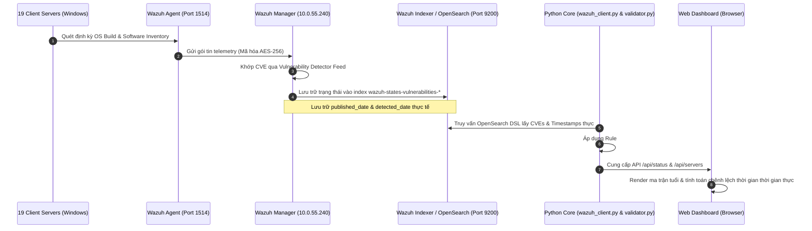

# Module 01: Tổng Quan Lỗ Hổng & Ma Trận Tuổi (Vulnerabilities Overview & Age Matrix)

## 1. Giới Thiệu & Mục Tiêu Chức Năng
Module **Vulnerabilities Overview** đóng vai trò là bảng điều khiển điều hành trung tâm (Executive Security Operations Dashboard), cung cấp cái nhìn toàn cảnh về tình hình an ninh mạng và mức độ phơi nhiễm lỗ hổng (Vulnerability Exposure) trên toàn bộ hạ tầng 19 máy chủ Windows Server của BPVN.

### Các thành phần chính trên giao diện:
1. **4 Thẻ KPI Tổng Thể:**
   - **Total Vulnerabilities (1,519)**: Tổng số lỗ hổng phát hiện từ tiến trình quét Wazuh Vulnerability Detector.
   - **Fixable Vulnerabilities (Rule #4 OS KB) (470)**: Số lỗ hổng đã được bảo vệ hoàn toàn bởi các gói cập nhật tích lũy Windows LCU (Cumulative Update) dựa trên số hiệu Build Kernel thực tế của máy chủ.
   - **Vulnerabilities With Manual Resolution (1,049)**: Số lỗ hổng cần xử lý vật lý (gồm bản vá OS còn thiếu trên các node chưa lên LCU mới nhất và ứng dụng bên thứ 3 lỗi thời).
   - **Vulnerabilities Discovered in last 1 day(s) (0)**: Đo lường mức độ biến động trong chu kỳ quét 24h gần nhất.
2. **Biểu Đồ Phân Bổ Mức Độ Nghiêm Trọng (Severity Summary Donut):**
   - Phân loại trực quan: **Critical: 24**, **Important: 1,025**, **Moderate: 470**, **Low: 0**.
3. **Ma Trận Tuổi Lỗ Hổng (Vulnerability Age Matrix):**
   - Phân tích rủi ro theo thời gian tồn tại: `> 90 ngày`, `60-90 ngày`, `30-60 ngày`, `< 30 ngày`.
   - **2 Góc nhìn độc lập**: Theo ngày công bố quốc tế (**Published Date**) và theo ngày Wazuh phát hiện trên node (**Discovered Date**).
   - Bộ lọc xem theo từng máy chủ cụ thể hoặc toàn bộ 19 máy chủ.
4. **Zero-day & Critical Top Focus Donut:**
   - Tập trung vào các lỗ hổng nguy hiểm nhất (MadLicence, Outlook Moniker Link, Wi-Fi Driver RCE...).
5. **Dòng Thời Gian Lỗ Hổng Theo Tháng (Vulnerabilities Over Time):**
   - Biểu đồ đường thể hiện xu hướng giảm mạnh số lỗ hổng sau khi kích hoạt thẩm tra Rule #4 LCU (giảm 71% cảnh báo giả).

---

## 2. Kiến Trúc Luồng Dữ Liệu & Đồng Bộ Đối Tượng

---

## 3. Chi Tiết Tương Tác & Đối Tượng Kỹ Thuật

| Nhóm Đối Tượng | Giao Thức / Cổng | Chi Tiết Dữ Liệu Đồng Bộ |
| :--- | :--- | :--- |
| **Client Servers -> Wazuh Agent** | Local WMI / Registry | Đọc số hiệu Windows Kernel Build (`CurrentBuildNumber`, `UBR`) và danh sách Hotfix trong `Win32_QuickFixEngineering`. |
| **Wazuh Agent -> Wazuh Manager** | TCP 1514 (AES-256) | Đồng bộ các sự kiện thay đổi gói phần mềm (Syscollector events). |
| **Wazuh Manager -> Wazuh Indexer** | HTTPS 9200 (OpenSearch) | Ghi nhận tài liệu lỗ hổng với metadata thời gian (`published`, `detected`). |
| **Python Core -> Wazuh Indexer** | REST API OpenSearch | Trích xuất `published_date` và `detected_date` thực tế, không sinh mẫu giả định. |
| **Python Core -> Web UI** | HTTP 8080 (`/api/status`) | Cung cấp số liệu tổng hợp, ma trận thời gian và danh mục kiểm toán lỗ hổng. |

---

## 4. Quy Chuẩn Thẩm Tra Rule #4 (Zero False Positives)
- **Cơ chế**: Microsoft áp dụng mô hình Cumulative Update (LCU), bản vá mới nhất chứa toàn bộ các bản vá của các tháng trước.
- **Nguyên lý kiểm toán**: Khi Kernel Build của máy chủ (ví dụ `10.0.17763.9245` trên Windows Server 2019) đã cao hơn hoặc bằng bản vá Cumulative Update yêu cầu của CVE, hệ thống tự động xác nhận lỗ hổng đã được khắc phục vật lý (`remediated_pending_rescan` / Rule #4 LCU), giúp quản trị viên loại bỏ các cảnh báo sai.

