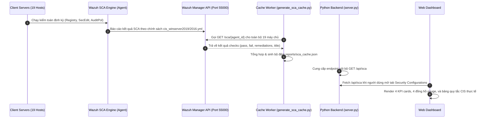

# Module 02: Cấu Hình An Toàn Hệ Thống (Security Configurations & CIS Benchmark SCA)

## 1. Giới Thiệu & Mục Tiêu Chức Năng
Module **Security Configurations** chuyên trách đo lường mức độ tuân thủ tiêu chuẩn an toàn hệ điều hành theo chuẩn quốc tế **CIS (Center for Internet Security) Benchmarks** cho các phiên bản Windows Server 2016, 2019 và 2022 trong mạng BPVN.

### Các thành phần chính trên giao diện:
1. **4 Thẻ KPI Đo Lường CIS Thực Tế:**
   - **Total System Misconfigurations (2,666)**: Tổng số bài kiểm tra cấu hình thất bại (Failed Checks) trên toàn bộ các chính sách CIS đang áp dụng.
   - **Passed Compliances (908)**: Tổng số bài kiểm tra cấu hình đạt chuẩn bảo mật an toàn (Passed Checks).
   - **Fleet CIS Compliance Score (40.1%)**: Điểm tuân thủ trung bình toàn mạng (`Passed / Total * 100`).
   - **Wazuh SCA Scanned Systems (16 / 19)**: Số lượng máy chủ đã được đồng bộ profile kiểm toán CIS hoàn chỉnh (3 máy chủ ảo hóa chạy cấu hình tối giản).
2. **4 Đồng Hồ Đo Trọng Điểm An Ninh (Security Health Gauges):**
   - **Windows Firewall Non-Compliant (9 Máy)**: Cảnh báo các máy chủ có profile tường lửa chưa kích hoạt hoặc thiếu chặn cổng inbound. Bấm vào mở modal danh sách máy kèm lệnh PowerShell bật tường lửa tự động trên 3 profiles.
   - **LDAP Signing / Channel Binding (11 Máy)**: Kiểm soát rủi ro tấn công Relay NTLM trên Domain Controller và máy chủ thành viên. Bấm vào mở script PowerShell ép buộc ký số LDAP.
   - **Wazuh EDR Agent Connection (19 / 19 Active - 100%)**: Trực quan hóa trạng thái duy trì liên lạc và giám sát tiến trình thời gian thực.
   - **Fleet CIS Compliance Score (40.1%)**: Bấm vào để drill-down bảng điểm chi tiết của từng máy chủ cụ thể (ví dụ: `BPVN-AD01: 52%`, `BPVN-HRSRV: 48%`, `SEDOSRV: 38%`...).
3. **Bảng Danh Mục Khuyến Nghị CIS Benchmark (System Misconfigurations Table):**
   - Danh sách chi tiết các bài kiểm tra thất bại: Tên quy tắc CIS, Phân loại (Active Directory, Network & SMB, Account & Logon Policy, System Services...), số máy chủ bị ảnh hưởng.
   - Bấm vào bất kỳ dòng nào để mở **Modal Hướng dẫn Khắc phục & Script PowerShell** được thiết kế riêng để triển khai qua Group Policy (GPO) hoặc Local Security Policy.

---

## 2. Kiến Trúc Luồng Dữ Liệu & Đồng Bộ Đối Tượng

---

## 3. Chi Tiết Tương Tác & Đối Tượng Kỹ Thuật

| Nhóm Đối Tượng | Giao Thức / Cổng | Chi Tiết Dữ Liệu Đồng Bộ |
| :--- | :--- | :--- |
| **Client Servers -> Wazuh Agent** | Local System Calls | Wazuh Agent chạy tiến trình `wazuh-agent.exe`, đọc Registry khóa `HKLM\System\CurrentControlSet\Services` và lệnh `secedit /export`. |
| **Wazuh Agent -> Wazuh Manager** | TCP 1514 (AES-256) | Truyền tải kết quả đánh giá SCA (Security Configuration Assessment). |
| **Wazuh Manager -> Cache Worker** | HTTPS 55000 (JWT Auth) | Gọi API `/sca/{agent_id}` để lấy danh sách policy (`cis_winserver2019.yml`, `cis_winserver2016.yml`) cùng trạng thái `failed`/`passed`. |
| **Cache Worker -> reports/sca_cache.json** | Local JSON File I/O | Lưu trữ telemetry 2,666 lỗi cấu hình và 908 pass check để giảm tải cho Wazuh Manager, đảm bảo độ trễ phản hồi UI < 10ms. |
| **server.py -> Web UI** | HTTP 8080 (`/api/sca`) | Phục vụ dữ liệu cấu hình an ninh, remediation script và danh sách máy chủ bị ảnh hưởng. |

---

## 4. Tự Động Hóa Khắc Phục (PowerShell & GPO Integration)
- Mỗi quy tắc kiểm toán thất bại đều đi kèm mã định danh chuẩn CIS (ví dụ: `CIS Microsoft Windows Server Benchmark 9.1.1` hoặc `2.3.7.4`).
- Nút **"📋 Sao Chép Script"** cung cấp trực tiếp đoạn mã PowerShell mẫu (ví dụ: `Set-NetFirewallProfile -Profile Domain,Public,Private -Enabled True`) giúp Quản trị viên hệ thống có thể kiểm tra trong cửa sổ bảo trì hoặc đóng gói thành GPO để áp dụng đồng loạt cho Domain Controller.

