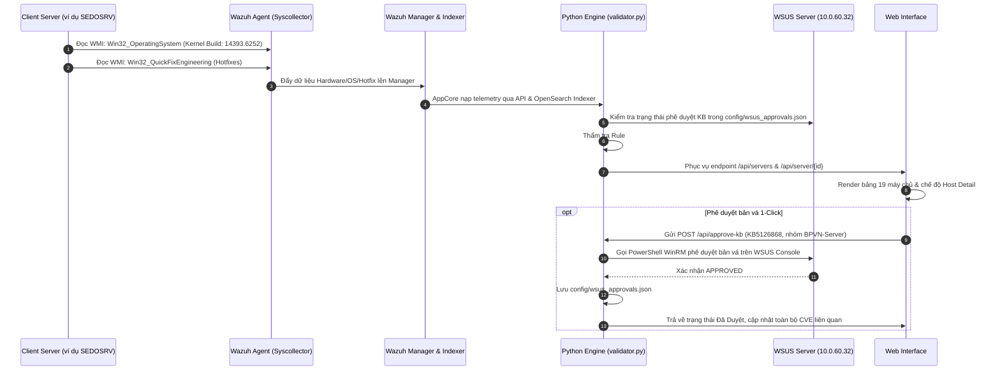

# Module 03: Quản Lý Hạ Tầng Máy Chủ (Systems & Fleet Management)

## 1. Giới Thiệu & Mục Tiêu Chức Năng
Module **Systems (19 Hosts)** là trung tâm quản lý tài sản và thiết bị đầu cuối (Endpoint Asset & Telemetry Center), kiểm soát toàn bộ 19 máy chủ Windows Server vật lý/ảo hóa trong mạng Best Pacific Việt Nam (BPVN).

### Các thành phần chính trên giao diện:
1. **Bảng Danh Sách 19 Máy Chủ (Fleet Table):**
   - **Máy Chủ & ID**: Tên định danh (Hostname) kèm ID Wazuh Agent (ví dụ: `BPVN-HYPERV03` - ID 001, `SEDOSRV` - ID 002, `ColorMaster` - ID 007, `BPVN-AD01` - ID 010...).
   - **Hệ Điều Hành & Kernel Build**: Tên HĐH chính xác kèm số hiệu Kernel Build vật lý (ví dụ: Windows Server 2019 Build `17763.9245`, Windows Server 2016 Build `14393.9512`...).
   - **Địa Chỉ IP**: IP cố định trong dải mạng nội bộ BPVN (`10.0.55.x`, `10.0.60.x`).
   - **WSUS Group**: Nhóm áp dụng chính sách cập nhật WSUS (`BPVN-Server`).
   - **Hotfix Đã Cài**: Số lượng bản vá KB vật lý đã nạp vào máy (từ 14 KBs đến 55 KBs).
   - **Lỗ Hổng Active**: Số lượng lỗ hổng thực tế còn tồn đọng cần vá.
   - **Trạng Thái Kiểm Toán**:
     - `✅ Sạch (Tuân thủ)`: Máy chủ đã được vá đầy đủ.
     - `✅ Sạch (Rule #4 LCU)`: Đã cài gói tích lũy mới nhất, bảo vệ toàn diện lõi HĐH.
     - `⚠️ X Cần vá`: Cần triển khai bản vá qua WSUS hoặc cập nhật phần mềm.
     - `🔄 Đã Cài KB • Chờ Restart`: Đã nạp gói KB, chờ khởi động lại máy để nạp vào Kernel.
     - `⚡ Đã Đẩy WSUS (X)`: Bản vá đã được phê duyệt trên WSUS, sẵn sàng để client cài đặt.
     - `⚠️ Mất Dữ Liệu Syscollector`: Cảnh báo node chưa đồng bộ Syscollector (như `BPVN-AD01`).
   - **Cờ Reboot**: Ghi nhận trạng thái `Reboot Required` và lý do khởi động lại.
   - **Nút "Chi tiết →"**: Mở màn hình quản trị chuyên sâu của máy chủ.

2. **Màn Hình Chi Tiết Máy Chủ (Host Detail View):**
   - **Thanh Tổng Hợp Bản Vá 1-Click (Top Batch Patch Summary Bar)**: Gom toàn bộ các lỗ hổng trùng gói KB (ví dụ `KB5126868`), cho phép Quản trị viên phê duyệt **1 Click duy nhất** cho toàn bộ 14 hoặc 45 CVEs cùng lúc.
   - **Bộ Lọc Nhanh Lỗ Hổng**: Lọc theo gói KB cụ thể hoặc ứng dụng Non-WSUS.
   - **Tab Danh Sách Lỗ Hổng (Vulnerabilities)**: Thẻ chi tiết từng CVE, CVSS, EPSS, CISA KEV, và nút kích hoạt cài đặt.
   - **Tab Bản Vá (Hotfixes)**: Hiển thị các mã KB đã cài đặt vật lý trên máy.
   - **Tab Phần Mềm (Software)**: Danh mục các phần mềm đang cài trên máy chủ lấy từ Syscollector.
   - **Tab Cấu Hình Bảo Mật (Security Config)**: Trạng thái cờ Reboot và kết nối EDR.

---

## 2. Kiến Trúc Luồng Dữ Liệu & Đồng Bộ Đối Tượng

---

## 3. Chi Tiết Tương Tác & Đối Tượng Kỹ Thuật

| Nhóm Đối Tượng | Giao Thức / Cổng | Chi Tiết Dữ Liệu Đồng Bộ |
| :--- | :--- | :--- |
| **Client Servers -> Wazuh Agent** | Local System Interop | Lấy thông tin OS Name, Kernel Build (`UBR`), RAM, Network Interfaces và Hotfixes đã cài đặt qua module Syscollector. |
| **Wazuh Agent -> Wazuh Manager** | TCP 1514 (AES-256) | Đồng bộ trạng thái Agent heartbeat và bảng dữ liệu phần cứng/phần mềm. |
| **Wazuh Manager -> Python Engine** | HTTPS 55000 & 9200 | Lấy danh sách máy chủ `/agents`, syscollector hotfixes, và index `wazuh-states-vulnerabilities-*`. |
| **Python Engine <-> WSUS Server** | WinRM HTTP 5985 / HTTPS 5986 | Thực thi script `scripts/Set-WsusApproval.ps1` thông qua tài khoản quản trị WSUS để phê duyệt bản vá và gán vào nhóm máy chủ `BPVN-Server`. |
| **Python Engine <-> Reboot Store** | Local JSON File | Quản lý trạng thái khởi động lại máy chủ trong `config/reboot_status.json`, cho phép xóa cờ hoặc đặt cờ restart. |
| **Python Engine -> Web UI** | HTTP 8080 (`/api/servers`) | Cung cấp dữ liệu đầy đủ của 19 máy chủ phục vụ bộ lọc tìm kiếm và bảng điều khiển. |
