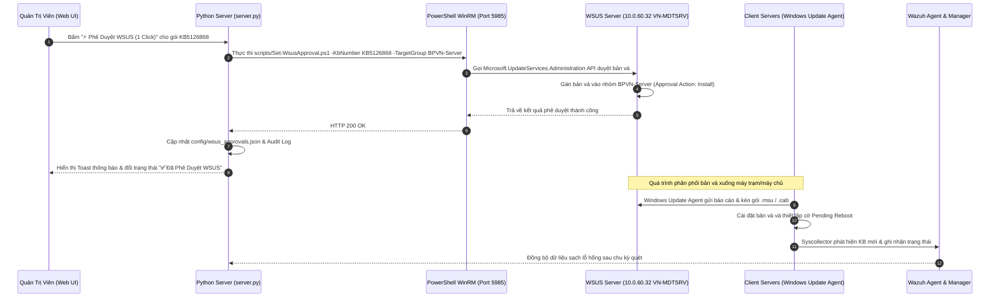

# Module 04: Trung Tâm Phê Duyệt & Quản Lý Bản Vá (Patch Management & Deployment)

## 1. Giới Thiệu & Mục Tiêu Chức Năng
Module **Patches** là trung tâm điều phối chiến dịch cập nhật an ninh (Patch Deployment & Fleet Remediation Center), thay thế hoàn toàn các thao tác thủ công phức tạp bằng quy trình tự động hóa giữa Web Dashboard, WSUS Server và Client Servers.

### Các thành phần chính trên giao diện:
1. **4 Thẻ KPI Sức Khỏe Bản Vá Toàn Mạng (100% Real Data):**
   - **Bản Vá Đã Cài Đặt (Fleet Hotfixes - 957)**: 381 mã KB duy nhất đang hoạt động vật lý trên 18/19 máy chủ.
   - **Bản Vá OS Thiếu (WSUS Patches - 3)**: Số gói bản vá Windows Server còn thiếu cần đẩy qua WSUS (`KB5126868`, `KB5040436`, `KB5029244`).
   - **Phần Mềm Lỗi Thời (Non-WSUS Apps - 4)**: Số ứng dụng bên thứ 3 cần nâng cấp thủ công/script (`7-Zip`, `Wireshark`, `Notepad++`, `PuTTY`).
   - **Máy Chủ Chờ Restart (Pending Reboot - 2)**: Các máy đã nạp bản vá vào ổ cứng, chờ khởi động lại ngoài giờ làm việc để nạp vào Kernel (`CSSERVER`...).

2. **4 Tab Con Phân Luồng Nghiệp Vụ:**
   - **Tab 1: 🪟 Bản Vá Hệ Điều Hành WSUS (3 gói)**:
     - Bảng thông tin: Mã KB, Tên gói Cumulative Update, Hệ điều hành áp dụng, Mức độ rủi ro & Số CVE được vá, Danh sách máy chủ cụ thể kèm IP.
     - Nút **"⚡ Phê Duyệt WSUS (1 Click)"** hoặc trạng thái `✅ Đã Phê Duyệt WSUS` kèm nút `Hủy`.
     - Bấm vào bất kỳ dòng nào mở **Modal Chi Tiết Bản Vá (`patchDetailModal`)** hiển thị toàn bộ CVEs và kịch bản PowerShell kích hoạt client kéo bản vá từ WSUS.
   - **Tab 2: 📦 Phần Mềm Bên Thứ 3 (4 ứng dụng)**:
     - Liệt kê phần mềm, phiên bản hiện tại, phiên bản an toàn khuyến nghị, máy chủ ảnh hưởng.
     - Nút **"📋 Script Khắc Phục"** cung cấp script PowerShell chạy qua `Invoke-Command` hoặc `winget`.
   - **Tab 3: 🔄 Máy Chờ Khởi Động Lại (2 máy)**:
     - Giám sát các máy có cờ `reboot_pending`, nút **"✅ Đã Restart (Xóa Cờ)"** và lệnh khởi động lại từ xa.
   - **Tab 4: 📋 Tra Cứu 957 Bản Vá Đã Cài (Installed Hotfixes Catalog)**:
     - Danh mục tra cứu nhanh bất kỳ mã KB nào trên toàn bộ 19 máy chủ.

---

## 2. Kiến Trúc Luồng Dữ Liệu & Đồng Bộ Đối Tượng

---

## 3. Chi Tiết Tương Tác & Đối Tượng Kỹ Thuật

| Nhóm Đối Tượng | Giao Thức / Cổng | Chi Tiết Dữ Liệu Đồng Bộ |
| :--- | :--- | :--- |
| **Web UI -> Backend** | HTTP 8080 (`/api/approve-kb`, `/api/unapprove-kb`) | Gửi payload `{ "kb": "KB5126868", "group": "BPVN-Server" }`. |
| **Backend -> WSUS Server** | WinRM HTTP 5985 / HTTPS 5986 | Sử dụng thư viện `pywinrm` hoặc gọi tiến trình PowerShell thực thi `scripts/Set-WsusApproval.ps1`. Kết nối tới `10.0.60.32` (`VN-MDTSRV.bestpacific.com`). |
| **WSUS Server -> Database WSUS** | Local Named Pipe / WID (SUSDB) | Thay đổi trạng thái bản vá trong cơ sở dữ liệu `SUSDB` sang `ApprovedForInstall`. |
| **WSUS Server -> Client Servers** | HTTP 8530 / HTTPS 8531 | Client Servers thực hiện `wuauclt /detectnow` hoặc `usoclient StartScan`, tải gói cập nhật từ kho lưu trữ `WsusContent`. |
| **Client Servers -> Wazuh Agent** | Local OS WMI | Wazuh Agent đọc danh sách Hotfix mới cài đặt và cập nhật Kernel Build sau khi máy chủ khởi động lại. |
| **Backend -> config/wsus_approvals.json** | Local File Storage | Lưu trữ nhật ký và dấu vết phê duyệt để đảm bảo đồng bộ tức thì trên Web UI mà không cần chờ WSUS quét lại. |
