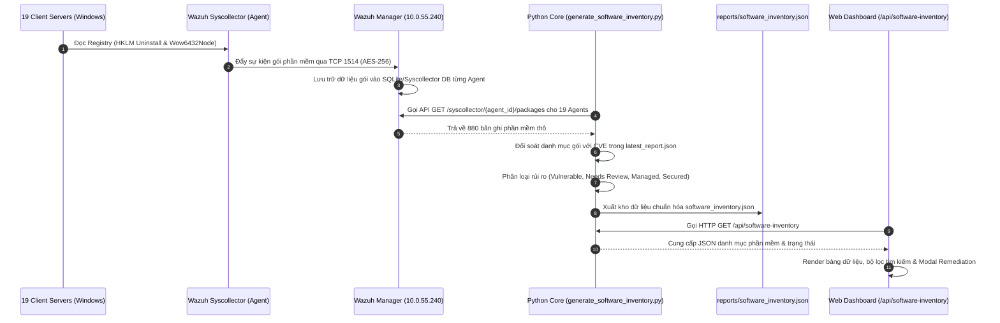

# Module 05: Quản Lý Phần Mềm Đã Cài Đặt (Installed Software & Product Risk Inventory)

## 1. Giới Thiệu & Mục Tiêu Chức Năng
Module **Installed Software & Product Risk Inventory** đóng vai trò là kho quản lý tài sản phần mềm tập trung (Software Asset & Risk Management) của hệ thống Patch Management, chịu trách nhiệm rà soát, lập danh mục và đánh giá rủi ro an ninh cho toàn bộ phần mềm được cài đặt trên 19 máy chủ Windows Server của BPVN.

### Các thành phần chính trên giao diện:
1. **Bảng Danh Mục Phần Mềm Toàn Hạ Tầng (Software & Product Risk Inventory):**
   - **Tên Ứng Dụng (Product / Application)**: Google Chrome, WinRAR Archiver, 7-Zip File Manager, PuTTY SSH Client, Commvault ContentStore, CrowdStrike Falcon Sensor, Microsoft Visual C++ Redistributable, Zabbix Agent 2...
   - **Phiên Bản & Ràng Buộc Bảo Mật (Version Constraint)**: Ghi nhận phiên bản đang cài đặt và ngưỡng an toàn tối thiểu (ví dụ: *WinRAR 6.11 - Cần lên 6.23* để vá CVE-2023-38831).
   - **Nhà Phát Triển (Vendor)**: Định danh nhà sản xuất (Google LLC, win.rar GmbH, Igor Pavlov, Simon Tatham, Commvault Systems, CrowdStrike Inc, Microsoft Corporation, Zabbix LLC...).
   - **Tỷ Lệ Phủ Trên Hệ Thống (Installed Hosts)**: Tỷ lệ cài đặt thực tế (ví dụ: Commvault 19/19 máy, CrowdStrike 19/19 máy, Zabbix 19/19 máy, Google Chrome 11/19 máy, 7-Zip 4/19 máy, PuTTY 3/19 máy).
   - **Trạng Thái Bảo Mật (Security Status Badges)**:
     - `Up to Date (An toàn)`: Phiên bản mới nhất, không có lỗ hổng CVE công bố.
     - `Vulnerable (CVE Detected)` / `Needs Review`: Ứng dụng chứa lỗ hổng bảo mật chưa vá cần nâng cấp.
     - `Active Protection`: Ứng dụng an ninh đầu cuối (CrowdStrike Falcon Sensor).
     - `Managed Enterprise`: Ứng dụng hạ tầng doanh nghiệp có quy trình quản lý riêng (Commvault).
     - `Monitored`: Ứng dụng giám sát hệ thống (Zabbix Agent 2).
   - **Biện Pháp Xử Lý Đề Xuất (Remediation Actions)**: Giám sát, Nâng cấp lên phiên bản an toàn, Gỡ bỏ ứng dụng thừa.
2. **Hộp Thoại Chi Tiết & Tự Động Hóa Xử Lý (Software Detail & Remediation Modal):**
   - Xem danh sách cụ thể từng máy chủ đang cài đặt (Hostname, IP, OS).
   - Danh sách các mã CVE liên kết với ứng dụng.
   - **Trình tạo kịch bản xử lý tự động (PowerShell Script Generator)**: Sinh script nâng cấp silent qua `winget`, tải MSI từ repo nội bộ hoặc gỡ bỏ qua WinRM chỉ với 1 click.

---

## 2. Kiến Trúc Luồng Dữ Liệu & Đồng Bộ Đối Tượng

---

## 3. Chi Tiết Tương Tác Giữa Các Nhóm Đối Tượng

| Nhóm Đối Tượng | Cơ Chế / Cổng | Chi Tiết Dữ Liệu Đồng Bộ |
| :--- | :--- | :--- |
| **Client Servers -> Wazuh Agent** | Local WMI / Registry | Trích xuất thông tin phần mềm từ 2 nhánh Registry chính: `HKLM\Software\Microsoft\Windows\CurrentVersion\Uninstall` `HKLM\Software\Wow6432Node\Microsoft\Windows\CurrentVersion\Uninstall` |
| **Wazuh Agent -> Wazuh Manager** | TCP 1514 (Encrypted) | Gửi delta updates mỗi khi có phần mềm cài mới, nâng cấp hoặc gỡ bỏ trên máy chủ. |
| **Wazuh Manager -> Python Core** | HTTPS 55000 (Wazuh API) | Python backend gọi API `/syscollector/{agent_id}/packages` để lấy đầy đủ name, version, architecture, vendor và install_date. |
| **Python Core -> reports/software_inventory.json** | Local File I/O | Hợp nhất 880 phần mềm, tính toán tỷ lệ phủ trên 19 máy chủ, gán cờ rủi ro và mã CVE tương ứng. |
| **Python Server -> Web Browser** | HTTP 8080 (`/api/software-inventory`) | Cung cấp dữ liệu dạng JSON cho giao diện tìm kiếm tức thì, lọc theo vendor và kích hoạt kịch bản khắc phục. |

---

## 4. Xử Lý Các Ứng Dụng Bên Thứ Ba Lỗi Thời (Non-WSUS Apps)
Khác với các bản vá hệ điều hành Windows được xử lý qua WSUS, các ứng dụng bên thứ 3 (như WinRAR, 7-Zip, PuTTY, Notepad++) không thể vá tự động qua WSUS. Module Installed Software đóng vai trò chốt chặn quan trọng:
1. **WinRAR**: Phát hiện các node cài phiên bản `< 6.23` dính lỗ hổng thực thi mã từ xa nghiêm trọng CVE-2023-38831 (đã có trong danh mục CISA KEV).
2. **7-Zip**: Phát hiện phiên bản `16.04` (lỗi thời nhiều năm) trên một số node nội bộ, kiến nghị nâng cấp lên `24.x`.
3. **PuTTY**: Phát hiện phiên bản `0.78` dính rủi ro khóa bảo mật ECDSA (CVE-2024-31497), yêu cầu nâng cấp lên phiên bản an toàn `0.80+`.
4. **Remediation Script**: Hệ thống tự động sinh script PowerShell tải bản cài silent từ thư mục chia sẻ nội bộ hoặc winget để kỹ sư IT có thể phân phối đồng loạt qua WinRM hoặc GPO Startup Scripts.
