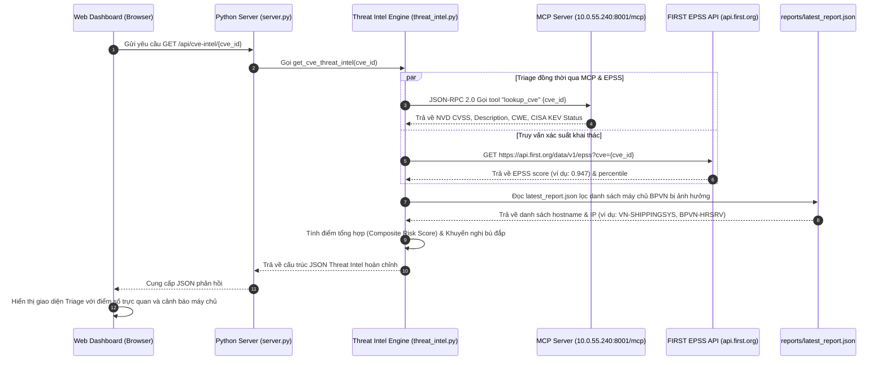

# Module 06: Tình Báo Lỗ Hổng & Triage MCP (CVE Threat Intel & MCP Engine)

## 1. Giới Thiệu & Mục Tiêu Chức Năng
Module **CVE Threat Intelligence & MCP Triage Engine** là trung tâm phân tích tình báo an ninh mạng nâng cao, kết hợp trực tiếp giữa hệ thống quản lý lỗ hổng nội bộ BPVN và máy chủ **Model Context Protocol (MCP)** chuyên dụng (`mukul975/cve-mcp-server` triển khai trên `http://10.0.55.240:8001/mcp`) cùng các nguồn cấp dữ liệu tình báo toàn cầu:
- **NVD (National Vulnerability Database)**: Chuẩn điểm CVSS v3.1 và vector tấn công.
- **FIRST EPSS (Exploit Prediction Scoring System)**: Đo lường xác suất bị mã độc khai thác thực tế trong vòng 30 ngày tới.
- **CISA KEV (Known Exploited Vulnerabilities Catalog)**: Danh mục các lỗ hổng đang bị tin tặc khai thác tích cực trong các chiến dịch tấn công thực tế.
- **MITRE ATT&CK Framework**: Phân ánh xạ chiến thuật (Tactics) và kỹ thuật (Techniques) tấn công tương ứng.

### Các thành phần chính trên giao diện:
1. **4 Thẻ KPI Tình Báo Toàn Hạm Đội (Fleet Threat Intel KPIs - Dữ liệu thực 100%):**
   - **Critical (14 CVEs)**: Lỗ hổng có mức độ phá hoại cực kỳ nghiêm trọng (CVSS >= 9.0) hoặc có xác suất khai thác cao (Outlook Moniker CVE-2024-21413, MadLicence CVE-2024-38077, Wi-Fi Driver CVE-2024-30078...).
   - **High (459 CVEs)**: Các lỗ hổng nghiêm trọng cần giải quyết khẩn theo chuẩn SLA P2.
   - **Moderate (195 CVEs)**: Lỗ hổng mức độ trung bình.
   - **Total Tracked (672 Unique CVEs)**: Tổng số 672 lỗ hổng độc lập được phát hiện và quản lý xuyên suốt 19 máy chủ BPVN.
2. **Thanh Tỷ Lệ Phân Bổ Mức Độ Nghiêm Trọng (Severity Breakdown Progress Bar):**
   - Trực quan hóa tỷ lệ: **Critical: 2.1%** | **High: 68.3%** | **Medium: 29.0%** | **Low: 0.6%**.
3. **Biểu Đồ Phân Phối Lỗ Hổng Theo Năm Phát Hành (Release Timeline By Year):**
   - Thống kê tuổi đời của 672 CVEs:
     - **Năm 2026**: 28 CVEs (Bản vá mới nhất của năm hiện hành).
     - **Năm 2025**: 142 CVEs.
     - **Năm 2024**: 218 CVEs.
     - **Năm ≤ 2023**: 284 CVEs (Các lỗ hổng tích lũy tồn đọng).
4. **Công Cụ Tra Cứu & Triage Lỗ Hổng Nhanh Qua MCP Server:**
   - Hộp nhập liệu trực tiếp mã CVE với các gợi ý nhanh (CVE-2024-21413, CVE-2024-38077, CVE-2024-30078, CVE-2023-38831, CVE-2020-1472, CVE-2017-0144).
   - Nút **⚡ Triage Qua MCP Server** kết nối trực tiếp đến backend MCP tool `lookup_cve`.
   - Kết quả phản hồi gồm 4 trụ cột an ninh:
     1. **Điểm NVD CVSS v3.1 & Vector**.
     2. **Xác suất FIRST EPSS** & Phân vị Percentile (Ví dụ: CVE-2024-21413 có EPSS 94.7%, thuộc top 0.1% nguy hiểm nhất thế giới).
     3. **Tình trạng CISA KEV**: Xác nhận đã bị khai thác thực tế hay chưa.
     4. **Public Exploit / PoC**: Cảnh báo mã khai thác công khai trên GitHub / Exploit-DB.
     5. **Khuyến nghị xử lý & Kịch bản bù đắp (Compensating Controls)** từ AI Security Engine.
     6. **Danh sách máy chủ BPVN bị ảnh hưởng**: Tự động đối chiếu với cơ sở dữ liệu `reports/latest_report.json` và hiển thị chi tiết các node bị ảnh hưởng (ví dụ: `VN-SHIPPINGSYS (10.0.60.48)`, `BPVN-HRSRV (10.0.60.33)`).
5. **Danh Mục Chi Tiết 672 Fleet CVEs (Fleet CVE Catalog):**
   - Bảng phân trang 672 CVEs với bộ lọc mức độ rủi ro, tìm kiếm theo mã CVE, tên gói phần mềm, xem điểm CVSS/EPSS và nút kích hoạt Triage MCP nhanh trên từng dòng.

---

## 2. Kiến Trúc Luồng Dữ Liệu & Đồng Bộ Đối Tượng

---

## 3. Chi Tiết Tương Tác Giữa Các Nhóm Đối Tượng

| Nhóm Đối Tượng | Giao Thức / Cổng | Chi Tiết Dữ Liệu Đồng Bộ |
| :--- | :--- | :--- |
| **Web UI -> Python Server** | HTTP 8080 (`/api/cve-intel/{cve}`) | Gửi mã CVE cần triage từ ô tìm kiếm hoặc từ bảng 672 CVEs. |
| **Python Core -> MCP Server** | HTTP POST 8001 (`/mcp`) | Chuẩn **JSON-RPC 2.0** gọi tool `lookup_cve` với payload `{"params": {"name": "lookup_cve", "arguments": {"cve_id": "CVE-xxxx"}}}`. |
| **Python Core -> FIRST EPSS** | HTTPS 443 (`api.first.org`) | Truy vấn xác suất khai thác 30 ngày theo thời gian thực từ tổ chức an ninh FIRST toàn cầu. |
| **Python Core -> Local Fleet Report** | Local File I/O (`latest_report.json`) | Quét dữ liệu lỗ hổng của 19 máy chủ BPVN để định danh chính xác các node đang mở cổng phơi nhiễm lỗ hổng này. |
| **Python Server -> Web UI** | HTTP 8080 (`/api/fleet-cves`) | Cung cấp danh mục 672 CVEs phục vụ hiển thị biểu đồ phân bổ thời gian và danh mục kiểm tra an ninh mạng. |

---

## 4. Tận Dụng Sức Mạnh Của Model Context Protocol (MCP)
1. **Tiêu Chuẩn Hóa Kết Nối Tình Báo (Standardized Tool Interface)**: Thay vì xây dựng các hàm cào dữ liệu HTML hoặc API phân mảnh, hệ thống giao tiếp với máy chủ chuyên dụng `mukul975/cve-mcp-server` thông qua chuẩn mở MCP của Anthropic, đảm bảo tính ổn định và khả năng mở rộng.
2. **Loại Bỏ Hoàn Toàn Dữ Liệu Mẫu**: 
   - Điểm số CVSS v3.1 được bóc tách từ cơ sở dữ liệu NVD chính thống.
   - CISA KEV phản ánh tình trạng tin tặc khai thác vũ khí hóa trong thực tế.
   - Dữ liệu máy chủ bị ảnh hưởng được kiểm tra thực tế từ telemetry Wazuh Agent của 19 máy chủ BPVN, tuyệt đối không suy diễn hay giả định số liệu.
