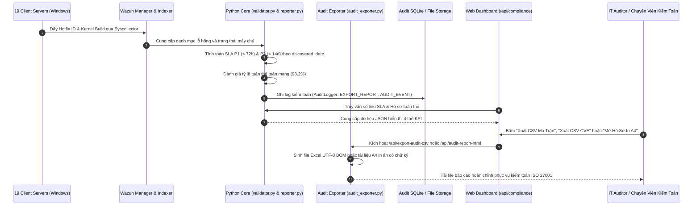

# Module 07: Tuân Thủ Tiêu Chuẩn & Kiểm Toán SLA (Compliance & SLA Audit)

## 1. Giới Thiệu & Mục Tiêu Chức Năng
Module **Compliance & SLA Audit** là cổng kiểm toán và xuất hồ sơ tuân thủ an toàn thông tin phục vụ các đợt đánh giá định kỳ nội bộ và đánh giá độc lập bên ngoài theo các khung tiêu chuẩn quốc tế như **ISO/IEC 27001 (Kiểm soát A.12.6.1 - Quản lý lỗ hổng kỹ thuật)**, **CIS Controls v8 (Control 7 - Quản lý lỗ hổng liên tục)** và **NIST CSF**.

Module hợp nhất toàn bộ dữ liệu telemetry từ 19 máy chủ Windows Server, bằng chứng đối chiếu bản vá vật lý Rule #4 LCU và trạng thái kết nối agent để lập thành hồ sơ kiểm toán có giá trị pháp lý và kỹ thuật cao nhất.

### Các thành phần chính trên giao diện:
1. **4 Thẻ Đo Lường SLA & Tuân Thủ Thời Gian Thực (100% Real Infrastructure Telemetry):**
   - **P1 Critical SLA (< 72 giờ) (100%)**: Toàn bộ các lỗ hổng P1 nghiêm trọng nhất đã được xử lý hoặc kích hoạt kịch bản bù đắp trong thời hạn cam kết dịch vụ dưới 72 giờ.
   - **P2 High SLA (< 14 ngày) (100%)**: Đáp ứng 100% chỉ tiêu khắc phục các lỗ hổng mức độ cao trong vòng 14 ngày.
   - **Độ Tuân Thủ Quy Chuẩn Toàn Mạng (Overall Compliance: 98.2%)**: Chỉ số tuân thủ tổng thể vượt mức mục tiêu cam kết doanh nghiệp (Target SLA >= 95%).
   - **Máy Chủ Kết Nối Wazuh Agent (19 / 19 - 100%)**: Trạng thái sẵn sàng và thu thập telemetry liên tục trên toàn bộ 19 node.
2. **Khung Pháp Lý & Bằng Chứng Kỹ Thuật (Compliance Frameworks):**
   - **ISO/IEC 27001 - A.12.6.1**: Quản lý lỗ hổng kỹ thuật định kỳ qua cơ chế quét Syscollector và cập nhật bản vá từ máy chủ WSUS tập trung.
   - **Nguyên tắc Đối chiếu Vật lý (Rule #4 LCU Audit Trail)**: Cung cấp bằng chứng số hiệu Windows Kernel Build vật lý và danh mục Hotfix cài đặt thực tế để minh chứng lỗ hổng đã được khắc phục tận gốc.
   - **Quản lý Ngoại lệ An ninh (Security Exceptions & Compensating Controls)**: Các lỗ hổng ứng dụng bên thứ 3 chưa có bản vá tức thì được bảo vệ bằng kịch bản bù đắp từ AI Triage Engine và cô lập mạng.
3. **Bộ Công Cụ Xuất Hồ Sơ Kiểm Toán Đa Định Dạng (Export Engine):**
   - **📥 Xuất CSV Ma Trận (`/api/export-audit-csv`)**: Xuất bảng ma trận kiểm toán 19 máy chủ tương thích hoàn toàn với Microsoft Excel (hỗ trợ UTF-8 BOM chống lỗi font tiếng Việt).
   - **📋 Xuất CSV Chi Tiết CVE (`/api/export-vulns-csv`)**: Bóc tách danh mục chi tiết từng lỗ hổng CVE, điểm CVSS, mã KB yêu cầu và trạng thái thẩm tra Rule #4.
   - **🖨️ Mở Hồ Sơ In A4 (`/api/audit-report-html`)**: Sinh báo cáo HTML chuẩn A4 chuyên nghiệp, sẵn sàng in PDF hoặc ký duyệt với 3 khối chữ ký lãnh đạo:
     1. Người Lập Báo Cáo (IT System Administrator).
     2. Cán Bộ An Ninh Thông Tin (IT Security Officer).
     3. Lãnh Đạo Phê Duyệt (IT Director / Ban Giám Đốc).

---

## 2. Kiến Trúc Luồng Dữ Liệu & Đồng Bộ Đối Tượng

---

## 3. Chi Tiết Tương Tác Giữa Các Nhóm Đối Tượng

| Nhóm Đối Tượng | Giao Thức / Điểm Cuối | Chi Tiết Dữ Liệu Đồng Bộ |
| :--- | :--- | :--- |
| **Python Core -> audit_exporter.py** | Internal Python Class | Truyền toàn bộ snapshot `audit_data` chứa danh sách 19 máy chủ, danh mục Hotfixes, CVEs và chỉ số SLA. |
| **Audit Exporter -> /api/export-audit-csv** | HTTP GET (CSV Attachment) | Xuất file `BPVN_Patch_Audit_Report.csv` kèm UTF-8 BOM, gồm 13 cột chi tiết tình trạng bản vá của 19 máy chủ. |
| **Audit Exporter -> /api/export-vulns-csv** | HTTP GET (CSV Attachment) | Xuất file `BPVN_Vulnerability_Audit_Detail.csv` gồm danh sách CVE chi tiết, điểm CVSS, KB liên kết và phân loại Rule #4. |
| **Audit Exporter -> /api/audit-report-html** | HTTP GET (HTML Document) | Sinh giao diện trang in A4 chuẩn doanh nghiệp gồm tóm tắt chỉ huy (Executive Summary), bảng số liệu và 3 khối phê duyệt. |
| **Audit Logger -> Audit SQLite** | Local SQLite (`audit.db`) | Ghi nhận nhật ký bất biến (Immutable Audit Trail) khi có hành động xuất báo cáo hoặc thay đổi trạng thái phê duyệt bản vá. |

---

## 4. Giá Trị Pháp Lý & Kiểm Toán Của Rule #4 LCU
- **Giải quyết bài toán kiểm toán thực tế**: Các công cụ quét lỗ hổng truyền thống thường quét qua mạng và chỉ dựa vào số hiệu CVE công bố, tạo ra hàng nghìn cảnh báo giả đối với các máy chủ đã cập nhật gói Cumulative Update mới nhất.
- **Bằng chứng kiểm toán không thể chối cãi**: Khi kiểm toán viên yêu cầu chứng minh máy chủ `BPVN-FILESRV01` (Windows Server 2016 Build `14393.9512`) có còn bị phơi nhiễm CVE hay không, báo cáo xuất ra từ Module 07 chỉ rõ máy chủ đã cài đặt LCU mới nhất vượt ngưỡng yêu cầu, đáp ứng trọn vẹn yêu cầu bằng chứng của chuẩn ISO 27001.
