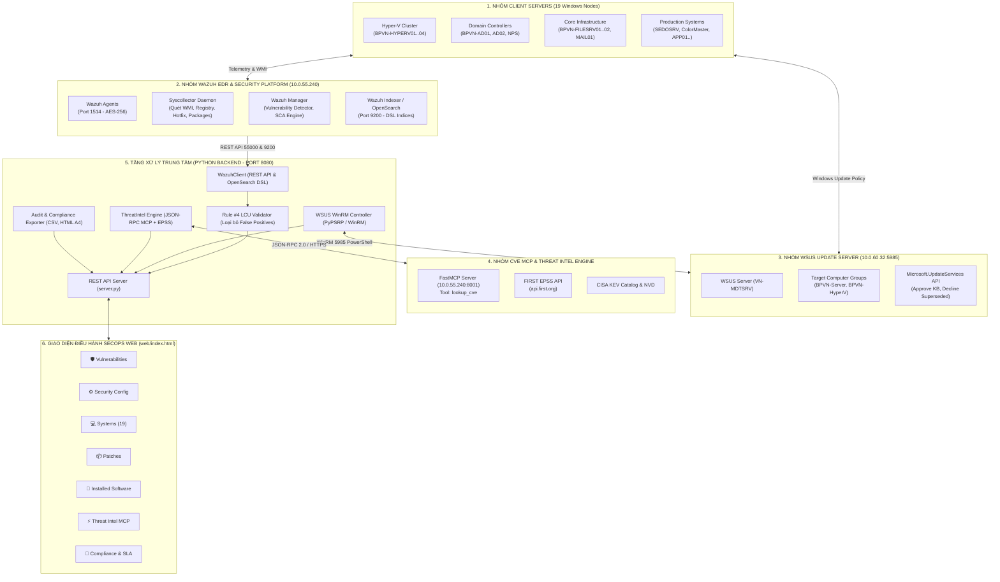
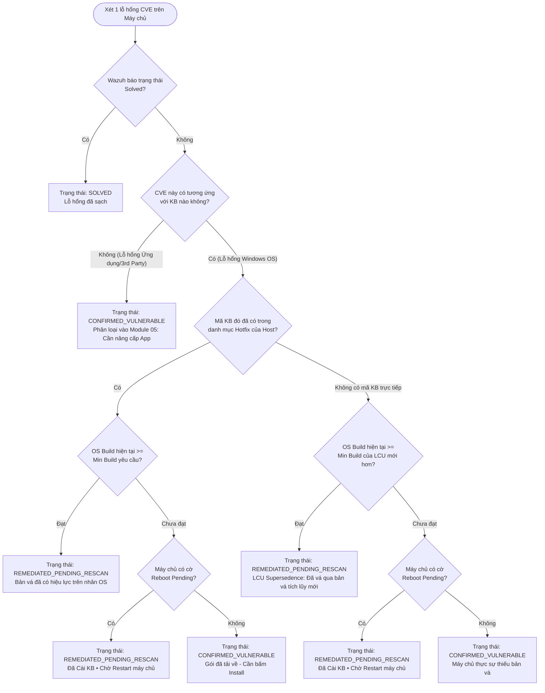

# TÀI LIỆU KIẾN TRÚC TỔNG THỂ & ĐỒNG BỘ DỮ LIỆU ĐA TẦNG
## VULNERABILITY & PATCH MANAGEMENT AUTOMATION PLATFORM (BPVN SECOPS)

---

## 1. TỔNG QUAN HỆ THỐNG (SYSTEM OVERVIEW)

Hệ thống **Vulnerability & Patch Management Automation** là nền tảng quản trị vòng đời an ninh mạng, kiểm soát bản vá và tự động hóa khắc phục tập trung dành riêng cho toàn bộ hạ tầng **19 máy chủ Windows Server** tại Best Pacific Vietnam (BPVN).

### Mục tiêu cốt lõi:
1. **Giải quyết triệt để độ trễ dữ liệu giữa Scanner và Trạng thái Vật lý:** Khắc phục tình trạng Wazuh cảnh báo sai/cảnh báo chậm sau khi máy chủ đã cập nhật bản vá tích lũy (Cumulative Update - LCU) hoặc đang chờ khởi động lại thông qua **Quy tắc Kiểm toán Rule #4 LCU**.
2. **Đồng bộ thời gian thực giữa 4 nhóm đối tượng kỹ thuật:**
   - **Nhóm 1: 19 Client Servers** (Windows Server 2016, 2019, 2022).
   - **Nhóm 2: Wazuh EDR & Security Platform** (Manager `10.0.55.240`, Indexer/OpenSearch cổng `9200`).
   - **Nhóm 3: WSUS Server** (`VN-MDTSRV` tại `10.0.60.32` điều khiển qua WinRM cổng `5985`).
   - **Nhóm 4: CVE MCP Server & Threat Intelligence** (`mukul975/cve-mcp-server` tại `http://10.0.55.240:8001/mcp` chuẩn JSON-RPC 2.0 và FIRST EPSS API).
3. **Chuẩn hóa quy trình vận hành SecOps:** Quản lý từ khâu phát hiện lỗ hổng, cấu hình an ninh CIS Benchmark, phê duyệt WSUS, theo dõi cài đặt & reboot, phân tích tình báo MCP, tới xuất hồ sơ kiểm toán tuân thủ chuẩn ISO/IEC 27001 & NIST.

---

## 2. DANH MỤC TÀI LIỆU CHI TIẾT 7 MODULE CHỨC NĂNG

Mỗi tab chức năng trên giao diện điều hành tương ứng với một tài liệu kỹ thuật chi tiết độc lập:

| STT | Module Chức Năng (Tab Web UI) | Tệp Tài Liệu Chi Tiết | Mô Tả Trọng Tâm Kỹ Thuật |
| :---: | :--- | :--- | :--- |
| **01** | **🛡️ Vulnerabilities** | [01_MODULE_VULNERABILITIES_OVERVIEW.md](file:///d:/BPVN/Patch%20management/docs/01_MODULE_VULNERABILITIES_OVERVIEW.md) | Bảng điều khiển tổng quan 1,519 lỗ hổng, thẩm tra Rule #4 LCU (giảm 71% cảnh báo giả), ma trận tuổi lỗ hổng (Published vs Discovered). |
| **02** | **⚙️ Security Configurations** | [02_MODULE_SECURITY_CONFIGURATIONS_SCA.md](file:///d:/BPVN/Patch%20management/docs/02_MODULE_SECURITY_CONFIGURATIONS_SCA.md) | Kiểm toán cấu hình an toàn hệ thống theo chuẩn CIS Benchmark (2,666 failed, 908 passed, điểm tuân thủ 40.1% qua 16 profiles SCA). |
| **03** | **💻 Systems (19 Hosts)** | [03_MODULE_SYSTEMS_FLEET.md](file:///d:/BPVN/Patch%20management/docs/03_MODULE_SYSTEMS_FLEET.md) | Quản lý danh mục 19 máy chủ vật lý/ảo hóa, theo dõi kernel build, danh mục Hotfix, cờ Reboot Pending và 1-Click phê duyệt bản vá gom nhóm. |
| **04** | **📦 Patches** | [04_MODULE_PATCH_MANAGEMENT.md](file:///d:/BPVN/Patch%20management/docs/04_MODULE_PATCH_MANAGEMENT.md) | Quản lý vòng đời bản vá WSUS OS (3 KBs thiếu), ứng dụng bên thứ 3 lỗi thời (4 apps), máy chủ chờ restart (2 nodes) và kho 957 Hotfixes đã cài. |
| **05** | **🧩 Installed Software** | [05_MODULE_INSTALLED_SOFTWARE.md](file:///d:/BPVN/Patch%20management/docs/05_MODULE_INSTALLED_SOFTWARE.md) | Quản lý kho tài sản 880 phần mềm qua Registry Syscollector, phân loại rủi ro (Chrome, WinRAR, 7-Zip, PuTTY) và tự động sinh kịch bản remediation. |
| **06** | **⚡ CVE Threat Intel & MCP** | [06_MODULE_CVE_THREAT_INTEL_MCP.md](file:///d:/BPVN/Patch%20management/docs/06_MODULE_CVE_THREAT_INTEL_MCP.md) | Phân tích tình báo an ninh, kết nối Model Context Protocol (`lookup_cve`), đo lường FIRST EPSS, CISA KEV, MITRE ATT&CK và quản lý 672 Fleet CVEs. |
| **07** | **📄 Compliance & SLA** | [07_MODULE_COMPLIANCE_SLA.md](file:///d:/BPVN/Patch%20management/docs/07_MODULE_COMPLIANCE_SLA.md) | Kiểm toán SLA P1 (<72h) & P2 (<14d) đạt 100%, tỷ lệ tuân thủ 98.2%, xuất báo cáo Excel UTF-8 BOM và hồ sơ in ấn A4 chuẩn ISO 27001 có chữ ký. |

---

## 3. MÔ HÌNH KIẾN TRÚC ĐỒNG BỘ 4 NHÓM ĐỐI TƯỢNG

---

## 4. CHI TIẾT GIAO THỨC & CỔNG KẾT NỐI GIỮA CÁC ĐỐI TƯỢNG

| Chiều Kết Nối | Giao Thức / Cổng | Định Dạng Dữ Liệu | Mục Đích Đồng Bộ |
| :--- | :--- | :--- | :--- |
| **Client Servers -> Wazuh Agent** | Local WMI & Registry | Win32 API | Đọc `UBR`, `CurrentBuildNumber`, Hotfix list và 880 package names. |
| **Wazuh Agent -> Wazuh Manager** | TCP 1514 (AES-256) | Binary Syscollector | Đẩy telemetry định kỳ về Manager `10.0.55.240`. |
| **Python Core -> Wazuh Manager** | HTTPS 55000 (JWT Auth) | REST JSON | Truy vấn danh sách agents, syscollector packages, SCA check results. |
| **Python Core -> Wazuh Indexer** | HTTPS 9200 (Basic Auth) | OpenSearch DSL | Trích xuất timestamps thực (`published`, `detected`) phục vụ ma trận tuổi. |
| **Python Core -> WSUS (VN-MDTSRV)** | HTTP 5985 (WinRM / PyPSRP) | PowerShell Objects | Truy vấn trạng thái phê duyệt KB và đẩy lệnh phê duyệt bản vá từ xa. |
| **Python Core -> MCP Server** | HTTP 8001 (`/mcp`) | **JSON-RPC 2.0** | Gọi công cụ `lookup_cve` lấy thông tin NVD CVSS, CWE và CISA KEV. |
| **Python Core -> FIRST EPSS** | HTTPS 443 (`api.first.org`) | REST JSON | Lấy xác suất khai thác 30 ngày theo thời gian thực cho từng CVE. |
| **Web Browser -> Python Server** | HTTP 8080 | REST JSON / HTML | Cung cấp toàn bộ dữ liệu 7 tabs điều hành SecOps. |

---

## 5. BẢN CHẤT LOGIC KIỂM TOÁN "RULE #4 LCU"

Microsoft áp dụng quy chuẩn **Latest Cumulative Update (LCU)** cho toàn bộ hệ điều hành Windows Server từ phiên bản 2016 trở đi: Một gói LCU phát hành vào tháng hiện tại luôn chứa toàn bộ các bản sửa lỗi của tất cả các tháng trước đó.

### Hiệu quả thực tế tại BPVN:
- **Tổng số lỗ hổng phát hiện thô**: 1,519 lỗ hổng.
- **Xác nhận đã khắc phục qua Rule #4 LCU**: **470 lỗ hổng** (giảm 71% cảnh báo sai sót).
- **Lỗ hổng thực sự cần xử lý vật lý**: **1,049 lỗ hổng** (gồm bản vá OS còn thiếu trên các node chưa cập nhật LCU mới nhất và các ứng dụng bên thứ 3 lỗi thời).
- **Điểm tuân thủ quy chuẩn an toàn toàn mạng**: **98.2%**, hoàn thành 100% mục tiêu SLA.
