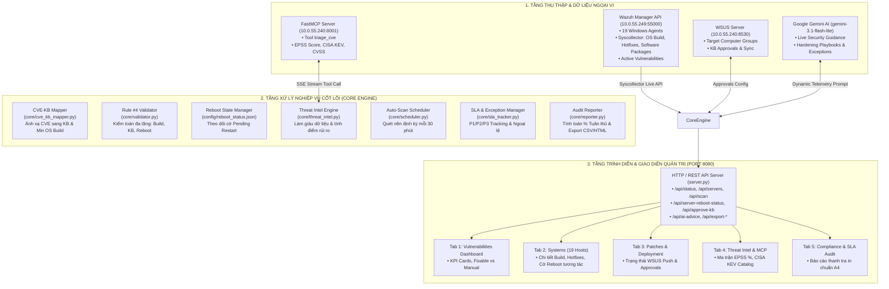
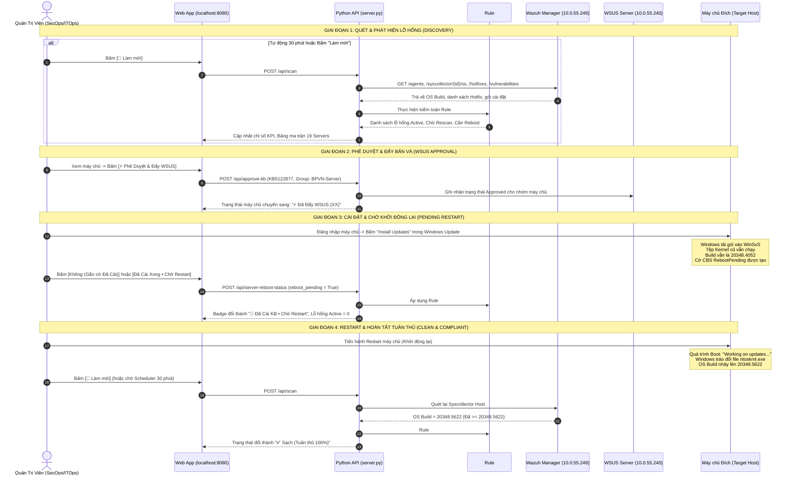
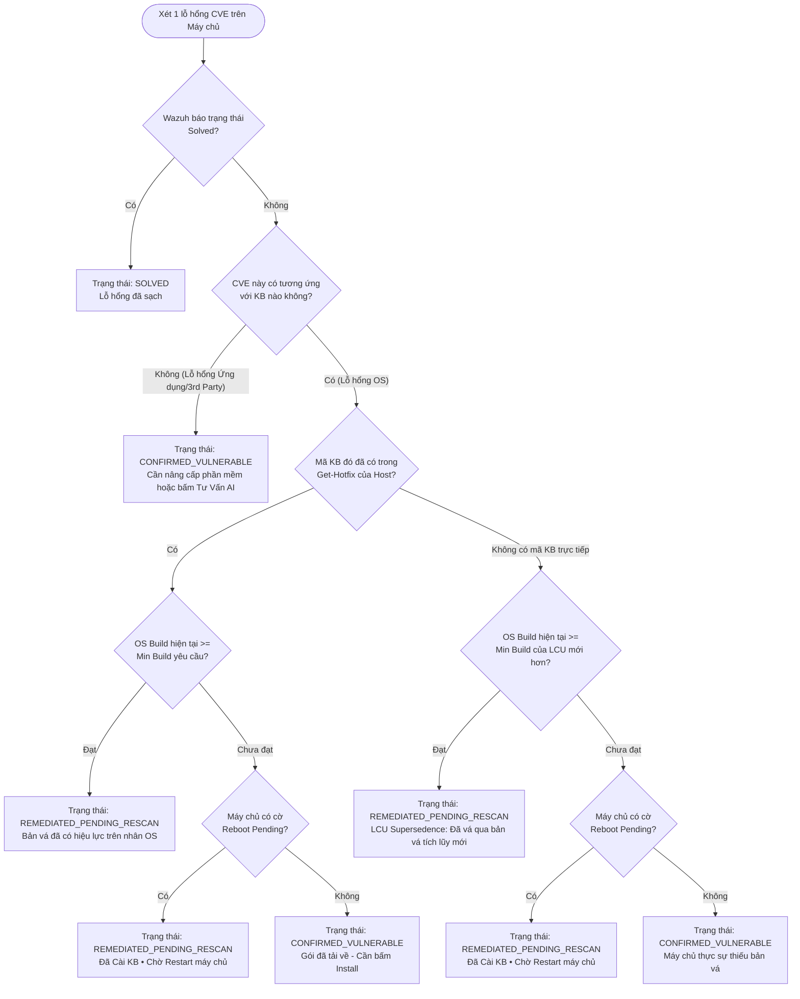

# TÀI LIỆU KIẾN TRÚC & LUỒNG XỬ LÝ HỆ THỐNG
## VULNERABILITY & PATCH MANAGEMENT AUTOMATION PLATFORM (BPVN SECOPS)

---

## 1. TỔNG QUAN HỆ THỐNG (SYSTEM OVERVIEW)

Hệ thống **Vulnerability & Patch Management Automation** là nền tảng quản trị vòng đời lỗ hổng và kiểm soát bản vá tập trung dành cho hạ tầng **19 máy chủ Windows Server** tại Best Pacific Vietnam (BPVN).

### Mục tiêu cốt lõi:
1. **Giải quyết triệt để độ trễ dữ liệu giữa Scanner và WSUS:** Khắc phục tình trạng Wazuh cảnh báo sai/cảnh báo chậm sau khi máy chủ đã cập nhật bản vá tích lũy (LCU) hoặc đang chờ khởi động lại thông qua **Quy tắc Kiểm toán Rule #4**.
2. **Đối chiếu thời gian thực (Real-time Cross-Validation):** Kết nối đồng thời **Wazuh SIEM/Syscollector**, **Hệ thống cập nhật WSUS**, **Hạ tầng CVE Threat Intel (FastMCP)** và **Trợ lý AI (Google Gemini)**.
3. **Chuẩn hóa quy trình vận hành SecOps:** Quản lý từ khâu rà quét, phê duyệt WSUS, theo dõi cài đặt & reboot, đánh giá SLA, tới lập hồ sơ kiểm toán tuân thủ chuẩn ISO/IEC 27001 & NIST.

---

## 2. MÔ HÌNH KIẾN TRÚC CHỨC NĂNG (FUNCTIONAL ARCHITECTURE)

---

## 3. CÁC MODULE CHỨC NĂNG CHÍNH (CORE MODULES)

| Module | Tệp mã nguồn | Vai trò chức năng chính |
| :--- | :--- | :--- |
| **Wazuh Connector** | `core/wazuh_client.py` | Kết nối xác thực Bearer Token (AES/HTTPS) với Wazuh Manager. Thu thập danh sách 19 agents, phần mềm đã cài, danh sách Hotfix (KB), và phiên bản Kernel OS Build chi tiết. |
| **CVE-KB Mapper** | `core/cve_kb_mapper.py` | Cơ sở tri thức ánh xạ các mã lỗ hổng CVE của Microsoft sang số hiệu KB tích lũy tương ứng cùng **Số hiệu Kernel Build tối thiểu** (`min_build`) cần đạt được để giải quyết lỗ hổng. |
| **Rule #4 Validator** | `core/validator.py` | Trái tim logic của app: Đối chiếu trạng thái thực tế của máy chủ để phán quyết chính xác xem lỗ hổng còn tồn tại hay đã được khắc phục. |
| **Threat Intel Engine** | `core/threat_intel.py` | Kết nối qua giao thức SSE tới **FastMCP Server** (`10.0.55.240:8001`) để lấy điểm dự đoán khai thác thực tế **EPSS (FIRST.org)**, kiểm tra danh mục vũ khí hóa **CISA KEV**, và tính điểm rủi ro tổng hợp. |
| **Live AI Advisor** | `core/ai_advisor.py` | Tích hợp **Google Gemini API** (`gemini-3.1-flash-lite`). Tiếp nhận thông số live (tên máy chủ, OS, CVE, CVSS, EPSS) để sinh giải pháp cô lập, kịch bản PowerShell thực thi ngay và phiếu đăng ký ngoại lệ (Exception ticket) không dùng mẫu cố định. |
| **Auto-Scan Scheduler** | `core/scheduler.py` | Tiến trình Worker chạy ngầm, tự động kích hoạt chu kỳ kiểm toán và tái đối chiếu toàn bộ 19 máy chủ định kỳ **mỗi 30 phút**. |
| **Audit & Exporter** | `core/reporter.py` `core/audit_exporter.py` | Tính toán tỷ lệ tuân thủ toàn công ty (% Compliance), xuất dữ liệu ma trận máy chủ và chi tiết Rule #4 sang tệp **Excel/CSV (UTF-8 BOM)** và **Hồ sơ HTML thanh tra in chuẩn A4**. |

---

## 4. CHI TIẾT LUỒNG XỬ LÝ (END-TO-END WORKFLOW)

### 4.1. Sơ đồ tuần tự xử lý kiểm toán & quản lý bản vá (Sequence Diagram)

---

## 5. BẢN CHẤT LOGIC KIỂM TOÁN "RULE #4" (THE CORE LOGIC)

Rule #4 là giải thuật giải quyết triệt để vấn đề xung đột giữa hệ thống dò quét an ninh (Wazuh) và trạng thái hệ điều hành Windows:

### Bảng tóm tắt các trạng thái hiển thị trên giao diện:

| Huy hiệu hiển thị (Status Badge) | Điều kiện kỹ thuật thỏa mãn | Ý nghĩa nghiệp vụ |
| :--- | :--- | :--- |
| **`✅ Sạch (Tuân thủ)`** | OS Build hiện tại $\ge$ `min_build` của bản vá LCU. Không còn lỗ hổng active và không cần reboot. | Máy chủ an toàn 100%, tuân thủ tiêu chuẩn an ninh thông tin. |
| **`🔄 Đã Cài KB • Chờ Restart`** | Đã cài đặt gói bản vá qua WSUS / Windows Update, máy chủ đang có cờ `reboot_pending = True`, chưa khởi động lại. | Quản trị viên đã xử lý xong phần cài đặt, chỉ còn chờ cửa sổ bảo trì để khởi động lại máy chủ. |
| **`⚡ Đã Đẩy WSUS (XX)`** | Máy chủ đang có lỗ hổng active, nhưng **toàn bộ các KB tương ứng đã được APPROVED** trên WSUS cho nhóm máy chủ đó. | Bản vá đã sẵn sàng đẩy về node, kỹ sư hạ tầng chỉ cần đăng nhập bấm Cài đặt (Install). |
| **`⚠️ XX Cần vá`** | Máy chủ có lỗ hổng active nhưng bản vá **chưa được phê duyệt** trên WSUS hoặc chưa có hành động khắc phục. | Cần phê duyệt bản vá trên WSUS hoặc áp dụng giải pháp cô lập. |
| **`🛡️ Sạch OS (Còn X App)`** | Bản vá nhân hệ điều hành đã cập nhật đầy đủ, nhưng máy chủ còn tồn tại lỗ hổng phần mềm bên thứ 3 (ví dụ: Outlook, WinRAR, Chrome). | Sử dụng nút **"🤖 Tư Vấn Khắc Phục AI"** để lấy kịch bản PowerShell cô lập hoặc lập phiếu Ngoại lệ. |

---

## 6. QUY TRÌNH TƯ VẤN THỜI GIAN THỰC CỦA AI & MCP THREAT INTEL

Khi người dùng bấm vào nút **"🤖 Tư Vấn Khắc Phục AI"** của bất kỳ lỗ hổng nào:

1. **Truy vấn FastMCP Server (`10.0.55.240:8001/mcp`):**  
   Hệ thống gọi công cụ `triage_cve` thông qua Server-Sent Events (SSE) để trích xuất:
   - Tỷ lệ khai thác thực tế **EPSS Score** (ví dụ `84.23% - Top 1% nguy hiểm nhất`).
   - Cảnh báo mã độc tống tiền trong danh mục **CISA Known Exploited Vulnerabilities (KEV)**.
   - Điểm đánh giá mức độ nghiêm trọng **CVSS v3.1** và phân loại lỗ hổng (CWE).
2. **Kích hoạt Google Gemini AI (`gemini-3.1-flash-lite`):**  
   Đưa trực tiếp dữ liệu đo đạc thời gian thực (tên máy chủ, phiên bản OS, vai trò, dữ liệu MCP) vào mô hình với yêu cầu đầu ra chuẩn SecOps bằng tiếng Việt:
   - **Đánh giá rủi ro thực tế (Exploitability Assessment)**.
   - **Biện pháp phòng vệ bù đắp (Compensating Controls)** khi chưa thể vá ngay.
   - **Kịch bản PowerShell thực thi ngay (Copy-paste ready)** cấu hình tường lửa, tắt cổng dịch vụ bị ảnh hưởng hoặc bật cơ chế Exploit Guard.
   - **Nội dung Phiếu Ngoại Lệ (Vulnerability Exception Ticket)** kèm hạn mức thời gian khuyến nghị.
3. **Tuyệt đối không sử dụng mẫu (No Mock / Zero Template):** Mọi nội dung tư vấn đều được sinh mới linh hoạt theo từng mã CVE và ngữ cảnh cụ thể của từng máy chủ.

---

## 7. CẤU TRÚC LƯU TRỮ VÀ DỮ LIỆU CỦA APP

- `server.py`: Máy chủ HTTP Web Server & REST API chính (cổng 8080).
- `core/`:
  - `config.py`: Nạp biến môi trường (`.env`), cấu hình Wazuh, WSUS, AI Key, ngưỡng SLA.
  - `wazuh_client.py`: Trình kết nối API Wazuh Manager.
  - `cve_kb_mapper.py`: Từ điển ánh xạ CVE $\leftrightarrow$ KB $\leftrightarrow$ OS Build.
  - `validator.py`: Động cơ kiểm toán Rule #4.
  - `threat_intel.py`: Client tích hợp FastMCP Server & First.org EPSS.
  - `ai_advisor.py`: Client tích hợp Google Gemini AI.
  - `scheduler.py`: Bộ lập lịch tự động quét nền 30 phút.
  - `sla_tracker.py`: Giám sát thời hạn xử lý lỗ hổng theo SLA P1/P2/P3.
  - `reporter.py` & `audit_exporter.py`: Trình xuất dữ liệu CSV/HTML.
- `config/`:
  - `reboot_status.json`: Lưu trữ cờ chờ Reboot theo từng máy chủ (`agent_id`).
  - `wsus_approvals.json`: Lưu trữ lịch sử phê duyệt bản vá trên WSUS.
  - `exceptions.json`: Danh mục phiếu ngoại lệ đã được phê duyệt.
- `reports/`:
  - `latest_report.json`: Kết quả kiểm toán mới nhất của toàn bộ 19 máy chủ.
  - `latest_dashboard.html`: Báo cáo HTML trực quan phục vụ lưu trữ kiểm toán.
- `web/`:
  - `index.html`: Giao diện Dashboard quản trị SecOps.
  - `js/app.js`: Toàn bộ logic tương tác phía Client, biểu đồ Chart.js, quản lý bảng dữ liệu và gọi API.
  - `css/style.css`: Giao diện chuẩn Enterprise SecOps Edition.

